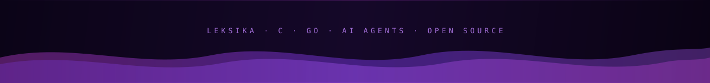

<div align="center">




<br />

<a href="https://github.com/LeksikaLang"></a>

<a href="https://about.me/zmlsag"></a>

</div>

## ✦ Обо мне

> **Leksika (Лексика)** — оригинальный русскоязычный язык программирования: падежная грамматика, кириллический синтаксис, собственный рантайм и компилятор **Lexus**. Программы живут в `.lek`-файлах и пишутся целиком по-русски.

- 🔮 **Сейчас** — развиваю **Leksika**: движок, нативное ядро на C11, сайт и браузерную песочницу
- 🧠 **Исследую** — AI-агенты, локальные LLM, агентные рантаймы и предохранители для кода
- 🧱 **Пишу на** — C, Go, Python
- 🪄 **Верю** — что язык программирования может звучать как родная речь

## 🧩 Стек

<div align="center">
  
</div>

## 🚀 Проекты

<table>
  <tr>
    <td width="50%" valign="top">
      <h3>Лексика · Leksika</h3>
      <p>Язык программирования на русском: падежная грамматика, кириллический синтаксис, свой рантайм и компилятор <b>Lexus</b>.</p>
      <p>
        <a href="https://github.com/zmlsaggg/Leksika"></a>
        
        
        
      </p>
      <p>
        <a href="https://leksika.gleeze.com/">Сайт</a> ·
        <a href="https://leksika.gleeze.com/playground.html">Песочница</a> ·
        <a href="https://github.com/zmlsaggg/Leksika">Код</a>
      </p>
    </td>
    <td width="50%" valign="top">
      <h3>State Sandbox</h3>
      <p>Экспериментальная игра-симуляция: LLM разыгрывают экономику, медиа, преступность и экологию, а вы проводите политику и смотрите на последствия.</p>
      <p>
        <a href="https://github.com/zmlsaggg/state-sandbox2"></a>
        
        
        
      </p>
      <p>
        <a href="https://state-sandbox2.vercel.app/">Играть</a> ·
        <a href="https://github.com/zmlsaggg/state-sandbox2">Код</a>
      </p>
    </td>
  </tr>
  <tr>
    <td width="50%" valign="top">
      <h3>Server</h3>
      <p>Сервер слотов на Go: выдача игр CT Interactive, Novomatic, NetEnt и BetSoft, сканер барабанов и наборы рилсов под разный RTP.</p>
      <p>
        
        
      </p>
      <p>
        <a href="https://github.com/zmlsaggg/server">Код</a>
      </p>
    </td>
    <td width="50%" valign="top">
      <h3>Экосистема</h3>
      <p>Установка как у обычного пакета: <code>.lek</code>-файлы рядом, <code>Leksika</code> в <code>PATH</code>.</p>
      <p>
        <a href="https://github.com/zmlsaggg/homebrew-leksika">homebrew-leksika</a> · macOS и Linux<br />
        <a href="https://github.com/zmlsaggg/scoop-leksika">scoop-leksika</a> · Windows<br />
        <a href="https://github.com/LeksikaLang">@LeksikaLang</a> · организация
      </p>
    </td>
  </tr>
</table>

### Руками потрогать

```text
пусть сумма равно пяти.
положить десять в сумму.
прибавить два к сумме.
сказать речь Сумма равна (сумма) конец речи.
```

Выведет `Сумма равна 12`. Запустить можно в [браузерной песочнице](https://leksika.gleeze.com/playground.html) — без установки.

## 📊 Статистика

<div align="center">


</div>

## 🐍 Змейка

<div align="center">

<picture>
  <source media="(prefers-color-scheme: dark)" srcset="https://raw.githubusercontent.com/zmlsaggg/zmlsaggg/output/snake-dark.svg" />
  <source media="(prefers-color-scheme: light)" srcset="https://raw.githubusercontent.com/zmlsaggg/zmlsaggg/output/snake.svg" />
  
</picture>

</div>

## 🌐 Ссылки

<div align="center">

<a href="https://leksika.gleeze.com/"></a>
<a href="https://leksika.gleeze.com/playground.html"></a>
<a href="https://github.com/zmlsaggg/Leksika/discussions"></a>
<a href="https://about.me/zmlsag"></a>

</div>


